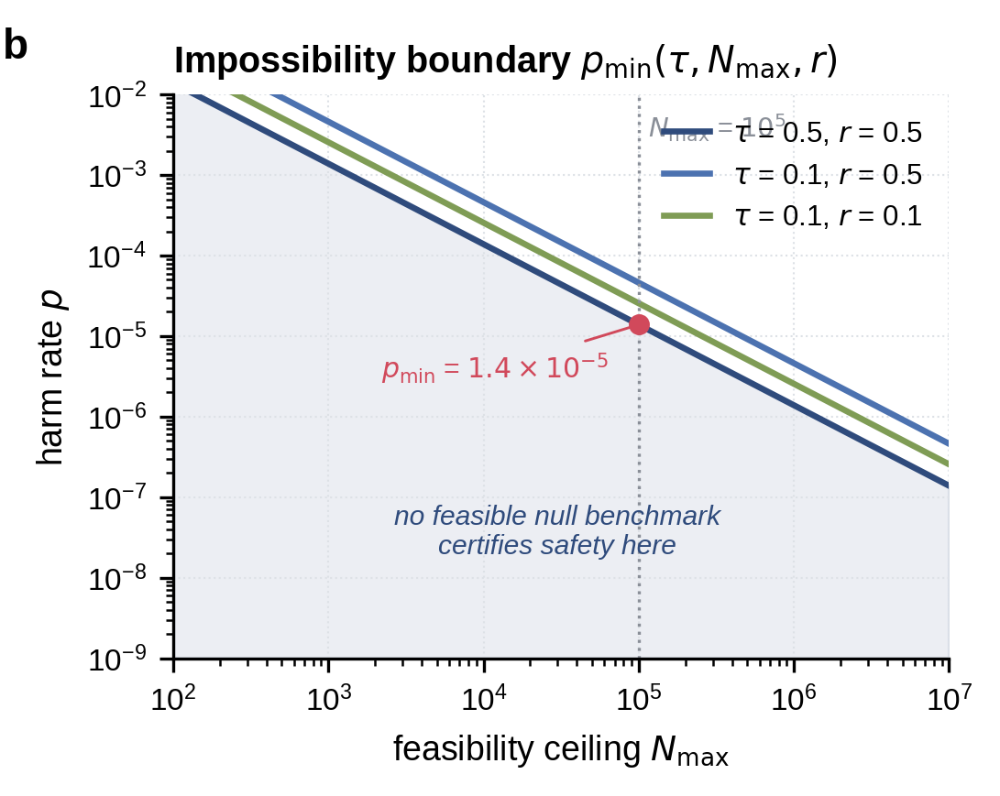

# What AI Red-Team Evaluations Can and Cannot Prove

Reproducibility code for:

> Bandana Kaur. *What AI Red-Team Evaluations Can and Cannot Prove*.
> arXiv:2607.21735, 2026. doi:[10.48550/arXiv.2607.21735](https://doi.org/10.48550/arXiv.2607.21735)

[Read the paper on arXiv](https://arxiv.org/abs/2607.21735) ·
[Use the calculator](https://hackwither.co.in/evidential-ceiling/)

The paper defines an evaluation's **evidential ceiling**: the largest factor by
which one feasible result can move belief between acceptable-risk and
elevated-risk hypotheses. For a benchmark null result, the boundary is
available in closed form. Existing benchmarks can support strong claims for
high-frequency harms, but cannot certify sufficiently rare harms at feasible
sample sizes.

<p align="center">
  
</p>

*Figure 3b. The boundary between feasible and infeasible null-result
certification. Cropped from the paper without altering the panel.*

Each curve gives the smallest harm rate <i>p</i><sub>min</sub> that a benchmark
can meaningfully certify for a maximum feasible sample size
<i>N</i><sub>max</sub>. The threshold τ is the required likelihood-ratio
threshold, smaller values demand stronger evidence and <i>r</i> is the
acceptable-to-elevated harm-rate ratio.
Points above a curve can be certified with some benchmark no larger than
<i>N</i><sub>max</sub>; points in the shaded region below it cannot. The
highlighted example shows that with <i>N</i><sub>max</sub> = 100,000, τ = 0.5,
and <i>r</i> = 0.5, the boundary is approximately
<i>p</i><sub>min</sub> = 1.4 × 10<sup>−5</sup>.

## Evidential Ceiling Calculator

[hackwither.co.in/evidential-ceiling](https://hackwither.co.in/evidential-ceiling/) answers
*what does this red-team result actually prove?* It runs entirely in the browser. Its maths lives
here, as pure functions with no dependencies:

```text
calculator/ceiling.js    the paper's quantities, in log space (log1p/expm1)
calculator/model.js      everything the calculator shows, from one state
calculator/verdict.js    the verdict sentence and methods paragraph
calculator/state.js      input parsing and the URL parameters (docs/url-parameters.md)
calculator/suites.js     the eight audited suites; ids are frozen
py/evidential_ceiling    Python twin of ceiling.js (pip install ./py)
test-vectors.json        every number the paper prints, shared by both test suites
docs/paper-extract.md    notation, formulas, worked examples and their sections
```

```bash
node --test 'calculator/*.test.js'
PYTHONPATH=py python -m unittest discover -s py/tests -v
```

```python
import evidential_ceiling as ec

ec.required_n(pu=1e-3, r=0.5, tau=0.1).exact      # 4602 (Table 4)
ec.p_min(tau=0.5, nmax=100_000, r=0.5).exact       # 1.386e-05 (§4.3)
ec.p_cross(n=520, r=0.5).approx                    # 1.333e-03 (Corollary 1)
```

The website copies `calculator/` in with `npm run sync:ceiling`; the page's version matches this
repository's release tag.

## Repository layout

```text
calculator/              Evidential Ceiling Calculator core (JavaScript) and tests
py/                      Python package evidential-ceiling, same functions and vectors
analysis/
  evidential_ceiling.py  Figure 1 and Tables 1, 2, and 4
  power_analysis.py      Figure 2 and Monte Carlo power results
  false_certification.py Figure 3 and Table 3
  distributional_gap.py Figure 4 and distributional-distance tables
  prepare_lmsys_sample.py
tests/                   Unit tests for the reported calculations
docs/assets/             Selected publication assets used in documentation
run_all.py               Complete reproduction entry point
requirements.txt         Paper software environment
data/                    Local source data; not version-controlled
outputs/                 Generated figures and tables; not version-controlled
```

## Install

Python 3.12 matches the paper environment.

```bash
python3.12 -m venv .venv
source .venv/bin/activate
pip install -r requirements.txt
```

The distributional analysis runs sentence-transformer inference on CPU and
downloads `all-MiniLM-L6-v2` on first use. The other analyses need no model or
API access.

## Prepare the gated LMSYS sample

Accept the LMSYS-Chat-1M terms on Hugging Face and authenticate locally, then
run:

```bash
python analysis/prepare_lmsys_sample.py \
  --output data/lmsys_sample.csv \
  --revision <paper-dataset-revision>
```

The script samples 10,000 conversations with seed 42 and checks for the 9,089
deduplicated first-user-turn queries reported in the paper.

## Reproduce all results
AdvBench and HarmBench are fetched from their upstream repositories by
default. To make the run entirely local:

```bash
python run_all.py \
  --lmsys-path data/lmsys_sample.csv \
  --advbench-path data/advbench_harmful_behaviors.csv \
  --harmbench-path data/harmbench_behaviors_text_all.csv
```

Results are written to `outputs/`. Each analysis can also be run independently
and documents its options under `--help`.

## Verify

```bash
python -m unittest discover -s tests -v
```

## Data and license

AdvBench, HarmBench, and LMSYS-Chat-1M retain their original licenses. No
proprietary data is used. Repository code is released under the [MIT
License](LICENSE).
